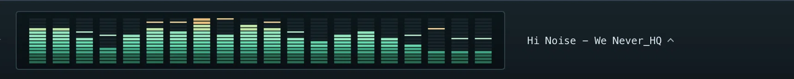
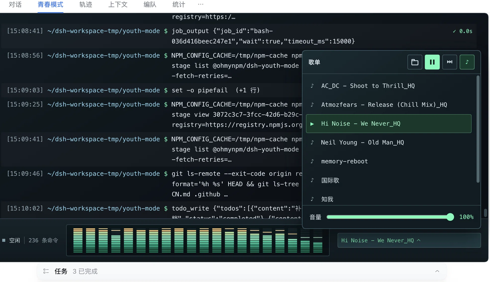

# DSH Youth Mode

`@ohmynpm/dsh-youth-mode` adds a terminal-style view for tool calls and command lines in DSH conversations. The player uses your own music, with a live spectrum and a typewriter that follows bass hits.

[简体中文](https://github.com/Of-qinhai/dsh-youth-mode/blob/main/docs/README.zh-CN.md) · [npm](https://www.npmjs.com/package/@ohmynpm/dsh-youth-mode)



## Quick start

1. In DSH Desktop or the Web UI, open **Plugins → Add plugin** and enter `@ohmynpm/dsh-youth-mode`.
2. Choose **Install → Enable now**, open a conversation, and select **Youth mode** at the top. If the tab is missing, refresh the interface and reopen the conversation.
3. Click **Choose a track** or the current track in the bottom bar. In the playlist, click the **folder icon** to the left of Play and add music to the folder that opens.
4. Return to DSH or wait about 10 seconds. Select a track or press Play. The volume slider is at the bottom of the playlist, and the browser remembers your setting.

You can also ask DSH to install and enable `@ohmynpm/dsh-youth-mode`. To install from GitHub or a `.tgz` archive, enter the repository URL or the archive’s absolute path in **Add plugin**. [GitHub repository](https://github.com/Of-qinhai/dsh-youth-mode)



## Features

- **Youth mode tab**: a new conversation view next to the normal chat; the default stays on chat.
- **Commands only**: a terminal transcript in the form `[time] ~/path $ command`; multi-line or huge commands collapse to the first line plus `(+N lines)`.
- **Typewriter**: commands reveal at `typeCps`, with a brief speed boost on pronounced bass hits. A system preference for reduced motion shows commands immediately.
- **Auto-scroll**: always follows new commands and streamed arguments.
- **BGM**:
  - The playlist loads automatically. With BGM enabled, the first visit starts at the first track.
  - Click the track name to open the playlist with play, pause, next track, and BGM controls. Next follows playlist order.
  - Resume a manually paused track from the same position. With automatic BGM enabled, typing or model output can resume music that faded out after inactivity or the end of a turn.
- **Status bar**: run state, command count, current track, and playback controls. A 20-column spectrum leaves room for drum hits even when the mix stays loud. The five blue-green bass columns rise and fall quickly, while their peak markers linger briefly.

## Music and configuration

### Scan the music folder automatically

The package ships with an empty `audio/` folder. It accepts `.mp3`, `.m4a`, `.aac`, `.ogg`, `.opus`, `.wav`, and `.flac` files, sorted by filename. Put the files in the directory opened by the playlist’s folder button. For remote DSH sessions, this directory is on the host machine.

### Choose tracks and their order

To keep music in a permanent location or play a specific set, add this override to your active DSH profile’s `cordis.patch.yml`. On macOS and Linux, the desktop profile is usually in `~/.dsh/profiles/desktop/`.

```yaml
- id: youth-mode
  name: '@ohmynpm/dsh-youth-mode'
  config:
    tracks:
      - '/Users/your-name/Music/Youth Mode/intro.mp3'
      - '/Users/your-name/Music/Youth Mode/chill.flac'
    volume: 0.45
```

Replace the example paths with real absolute paths on the DSH host. Relative filenames resolve inside the plugin’s `audio/` folder. An explicit list plays in the order you enter, and `tracks: []` restores automatic scanning. A saved slider setting takes precedence over `volume`. If you installed a local checkout or installed from GitHub, use `@local/youth-mode` for `name`.

### Other options

See the [bundle configuration](https://github.com/Of-qinhai/dsh-youth-mode/blob/main/cordis.patch.yml) for defaults. If changes do not take effect, reopen DSH.

| Key | Default | Description |
| --- | --- | --- |
| `tracks` | empty (scan `audio/`) | Optional selection of tracks. Relative names resolve under `audio/`. Absolute paths also work. |
| `inChars` | `24` | Input length that starts playback |
| `outChars` | `0` | Output length that starts playback; `0` = as soon as the model streams |
| `volume` | `0.45` | Target volume (0–1) |
| `idleMs` | `1500` | Silence before fading out |
| `fadeInMs` | `10000` | Fade-in duration (enforced minimum of 10 s) |
| `fadeOutMs` | `10000` | Fade-out duration |
| `typeCps` | `30` | Typewriter speed (chars/sec) |
| `mode` | `auto` | Default mode for the first run; the `♪` toggle remembers afterwards |

### Troubleshooting

- **The playlist is empty.** Check the folder opened by the playlist button, or check the paths in `tracks`. Return to DSH and wait for the playlist to refresh.
- **A track is listed but silent.** Press Play and check the BGM toggle and volume. Your browser may require an interaction before autoplay starts.
- **Tracks disappeared after an update.** The plugin’s installation folder can change with each version. For music you want to keep across updates, store it in your own music folder and reference it through `tracks`.

## Usage

| Action | Behaviour |
| --- | --- |
| Switch to the Youth mode tab | Shows the terminal log (history appears complete, no typing replay) |
| Send after typing a long prompt | BGM starts immediately and runs through the turn |
| Track name in the bottom bar | Open the playlist and select a track to play. |
| Top of the playlist | Open the music folder in the file manager, play or pause, skip to the next track in order, or toggle BGM. |
| Bottom of the playlist | Adjust the volume. The browser remembers your setting. |

## How it works

- **Host half** ([index.js](index.js)) provides authenticated music endpoints.
  - `/api/youth-mode-bgm?config=1` returns the track list, including display names and stable identifiers, and the playback settings.
  - `/api/youth-mode-bgm?key=…` returns the audio file. The identifier survives playlist reordering.
  - `POST /api/youth-mode-bgm/open-folder` opens the plugin’s music folder on the DSH host.
- **Client half** ([client.js](client.js)) registers the tab through the `conversation.view` slot and folds the session event window (`tool/call`, `tool/result`, `assistant/live-chunk`) directly. It never subscribes to the model or writes session events.
- BGM is a browser `<audio>` element with timer-based volume ramps; the element is reused across tab switches.

## Known limitations

- The audio route does not support Range: the first load or a track switch downloads the whole file, so a slow file gives a short silence before the fade-in.
- If the browser blocks autoplay, the first click or key press retries playback.
- Multi-line commands show only the first line plus a line count, not the full heredoc.
- History is shown complete when the tab opens; no typing replay.
- Depends on DSH client internals (`session.eventSource`, the `conversation.view` slot, exact `/api` routes); a DSH upgrade may require follow-up changes.

## Releasing

Run `npm test` and `npm run pack:release` on Node.js 22 or later. The latter creates a shareable `dist/ohmynpm-dsh-youth-mode-<version>.tgz`. The package starts with an empty music folder, and local tracks stay in the development checkout.

A maintainer with `@ohmynpm` publishing access uploads the first version. Then configure npm Trusted Publishing for `release.yml` in `Of-qinhai/dsh-youth-mode`. For subsequent releases, push a `v<version>` tag matching the package version to run the tests and publish through GitHub Actions.

## Development

### Local directory (for development)

```bash
git clone https://github.com/Of-qinhai/dsh-youth-mode.git
```

Then use **Plugins → Add plugin** with the **absolute path** of that directory, install and enable. Local installs are symlinked, so code changes show up after a page refresh.

```bash
node test/smoke.mjs
```

The offline smoke test covers the Host route bytes, config sanitisation, event folding, streamed command assembly and typewriter advancement.

## Layout

```text
.
├── package.json         # bundle manifest (dsh.bundle.patch + dsh.client)
├── cordis.patch.yml     # plugin row and default config
├── index.js             # Host half: /api/youth-mode-bgm
├── client.js            # Client half: tab, terminal view, BGM
├── icon.svg
├── locale/              # Plugin Manager display strings
├── audio/               # local music directory
└── test/smoke.mjs
```
