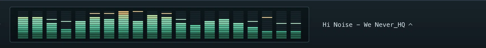
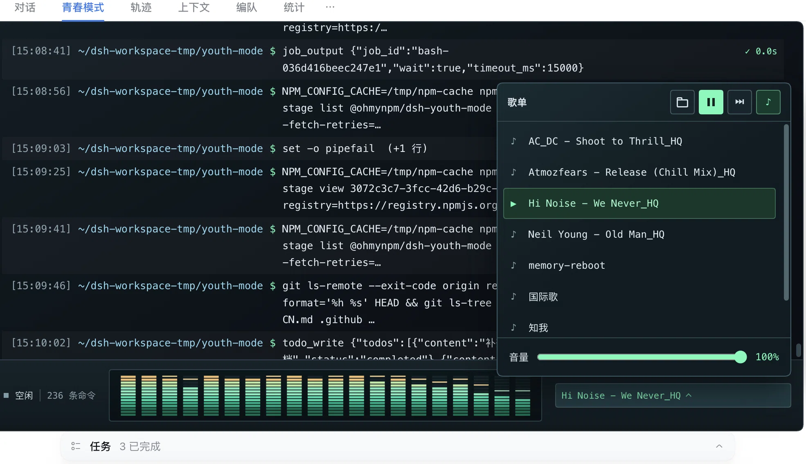

# 青春模式 · DSH Youth Mode

`@ohmynpm/dsh-youth-mode` 为 DSH 会话添加「青春模式」视图，集中显示工具调用和命令行。播放器使用你自己的音乐，频谱随音乐实时变化，打字机会跟随低频节拍。

[English](https://github.com/Of-qinhai/dsh-youth-mode/blob/main/README.md) · [npm](https://www.npmjs.com/package/@ohmynpm/dsh-youth-mode)



## 快速开始

1. 在 DSH 桌面端或 Web 界面打开 **Plugins → Add plugin**，输入 `@ohmynpm/dsh-youth-mode`。
2. 点击 **Install → Enable now**，打开一个会话，在顶部切到 **青春模式**。如果标签还没出现，刷新界面后再打开会话。
3. 点底栏的 **选择曲目** 或当前曲名，打开歌单。点播放按钮左边的**文件夹图标**，把音乐放进打开的目录。
4. 切回 DSH 或等约 10 秒。曲目出现后，点击曲名或播放按钮试听。音量滑杆在歌单底部，设置会保存在当前浏览器里。

也可以对 DSH 说「帮我安装并启用 `@ohmynpm/dsh-youth-mode`」。如果从 GitHub 或 `.tgz` 安装，在 **Add plugin** 中填写仓库 URL 或安装包的绝对路径即可。 [GitHub 仓库](https://github.com/Of-qinhai/dsh-youth-mode)



## 功能

- **青春模式 TAB**：在原来的对话旁边新增一个视图，默认仍停在普通对话。
- **只显示命令**：`[时间] ~/路径 $ 命令` 的终端 transcript；多行/超长命令压成首行 + `(+N 行)`。
- **打字机**：命令按 `typeCps` 逐字显示，检测到明显的低频鼓点时短暂加速。开启系统「减少动态效果」后直接显示完整命令。
- **自动滚动**：新命令和流式参数出现时始终贴底。
- **BGM**：
  - 自动读取歌单。首次进入且 BGM 开启时，从列表第一首开始播放；
  - 点底栏曲名打开歌单，可播放、暂停、按列表顺序切到下一首，或开关 BGM；
  - 手动暂停后，从原位置手动继续。自动播放模式下，长输入或模型输出可恢复因空闲或回合结束而淡出的音乐。
- **状态栏**：运行状态、命令数、当前曲目与播放控制。中间的 20 列分段频谱随 BGM 实时变化，峰值块停留片刻后缓慢回落。

## 音乐与配置

### 自动扫描音乐目录

安装包自带空的 `audio/` 目录。支持 `.mp3`、`.m4a`、`.aac`、`.ogg`、`.opus`、`.wav`、`.flac`，按文件名排序。直接把文件放进歌单里的文件夹按钮打开的目录即可。使用远程 DSH 时，这个目录在宿主机器上。

### 指定曲目与播放顺序

想把音乐保存在固定位置，或只播放指定曲目，可以在当前 DSH profile 的 `cordis.patch.yml` 中添加以下覆盖。macOS 和 Linux 的桌面 profile 通常位于 `~/.dsh/profiles/desktop/`。

```yaml
- id: youth-mode
  name: '@ohmynpm/dsh-youth-mode'
  config:
    tracks:
      - '/Users/your-name/Music/Youth Mode/intro.mp3'
      - '/Users/your-name/Music/Youth Mode/chill.flac'
    volume: 0.45
```

把示例改成 DSH 宿主上实际存在的绝对路径。相对文件名从插件的 `audio/` 查找。显式列表按填写顺序播放，`tracks: []` 恢复自动扫描。配置生效后，歌单里的音量滑杆优先于 `volume`。本地目录或 GitHub 安装使用 `@local/youth-mode` 作为上述配置的 `name`。

### 其他选项

默认值见 [插件配置](https://github.com/Of-qinhai/dsh-youth-mode/blob/main/cordis.patch.yml)。如果配置修改后未生效，重新打开 DSH。

| 键 | 默认 | 说明 |
| --- | --- | --- |
| `tracks` | 空（自动扫描 `audio/`） | 只播指定曲目时才填；相对名从 `audio/` 读，也可写绝对路径 |
| `inChars` | `24` | 输入达到多少字符后开始播放 |
| `outChars` | `0` | 输出达到多少字符开始；`0` = 模型一开始输出就播 |
| `volume` | `0.45` | 目标音量（0–1） |
| `idleMs` | `1500` | 停止打字多久后开始淡出 |
| `fadeInMs` | `10000` | 渐入时长（最低按 10 秒执行） |
| `fadeOutMs` | `10000` | 渐出时长 |
| `typeCps` | `30` | 打字机速度（字符/秒） |
| `mode` | `auto` | 首次运行的默认模式；之后由界面上的 `♪` 记忆 |

### 常见问题

- **歌单为空**：确认文件放在歌单按钮打开的目录中，或者检查 `tracks` 里的路径。然后切回 DSH 等待列表刷新。
- **有曲目但没声音**：在歌单中手动点一次播放，检查音符开关和音量。浏览器可能会要求先交互才能自动播放。
- **升级后找不到音乐**：插件的安装目录可能随版本一起更换。长期保留的曲目可以存放在自己的音乐目录，通过 `tracks` 引用。

## 使用

| 操作 | 行为 |
| --- | --- |
| 切到「青春模式」TAB | 显示终端日志（历史命令直接完整显示，不回放打字） |
| 长输入后发送 | BGM 立刻开始，贯穿本轮 |
| 底栏曲名 | 打开歌单，点击曲名直接播放 |
| 歌单顶部 | 在系统文件管理器中打开音乐目录，播放／暂停，按顺序切到下一首，或开关 BGM |
| 歌单底部 | 调节音量，设置会保存在当前浏览器中 |

## 原理

- **Host 半**（[index.js](index.js)）提供需要登录态的音乐接口。
  - `/api/youth-mode-bgm?config=1` 返回曲目的序号、稳定标识、文件名及播放配置。
  - `/api/youth-mode-bgm?key=…` 返回音频文件。目录重新排序时，标识仍指向同一首曲目。
  - 向 `/api/youth-mode-bgm/open-folder` 发送 POST 请求会在 DSH 宿主机器上打开插件的音乐目录。
- **Client 半**（[client.js](client.js)）通过 `conversation.view` 插槽注册 TAB，直接折叠会话事件窗口（`tool/call` / `tool/result` / `assistant/live-chunk`），不订阅模型、不写会话日志。
- BGM 是浏览器 `<audio>`，音量用定时器做淡入淡出；歌曲元素在插件实例内复用，切 TAB 不会重新选歌。

## 已知限制

- 音频路由不支持 Range：切歌/首次加载会整首下载，慢的时候有一小段静音，之后才渐入。
- 如果浏览器拦截自动播放，点击或按键后会重试首播。
- 多行命令只显示首行摘要，不显示完整 heredoc。
- 历史命令在打开 TAB 时直接完整显示，不做打字回放。
- 依赖 DSH 客户端内部接口（`session.eventSource`、`conversation.view` 插槽、`/api` 精确路由），DSH 升级后可能需要跟随调整。

## 发布

用 Node.js 22 或更新版本运行 `npm test` 和 `npm run pack:release`。后者生成 `dist/ohmynpm-dsh-youth-mode-<版本>.tgz`，可直接分享。包内保留空音乐目录，本地曲目留在开发目录。

首次发布由有 `@ohmynpm` 发布权限的维护者上传此包。随后在 npm 为 `Of-qinhai/dsh-youth-mode` 的 `release.yml` 配置 Trusted Publishing。后续推送与版本号匹配的 `v<版本>` 标签，GitHub Actions 会测试并发布。

## 开发

### 本地目录安装（开发用）

```bash
git clone https://github.com/Of-qinhai/dsh-youth-mode.git
```

然后在 **Plugins → Add plugin** 里填这个目录的**绝对路径**，安装并启用。本地目录安装是软链接，改完代码刷新页面即可。

```bash
node test/smoke.mjs
```

离线冒烟测试覆盖：Host 路由返回音频字节、配置脱敏、事件折叠、流式命令拼接、打字机推进。

## 目录

```text
.
├── package.json         # bundle 清单（dsh.bundle.patch + dsh.client）
├── cordis.patch.yml     # 插件行与默认配置
├── index.js             # Host 半：/api/youth-mode-bgm
├── client.js            # Client 半：TAB、终端视图、BGM
├── icon.svg
├── locale/              # 插件管理器展示文案
├── audio/               # 本地音乐目录
└── test/smoke.mjs
```
